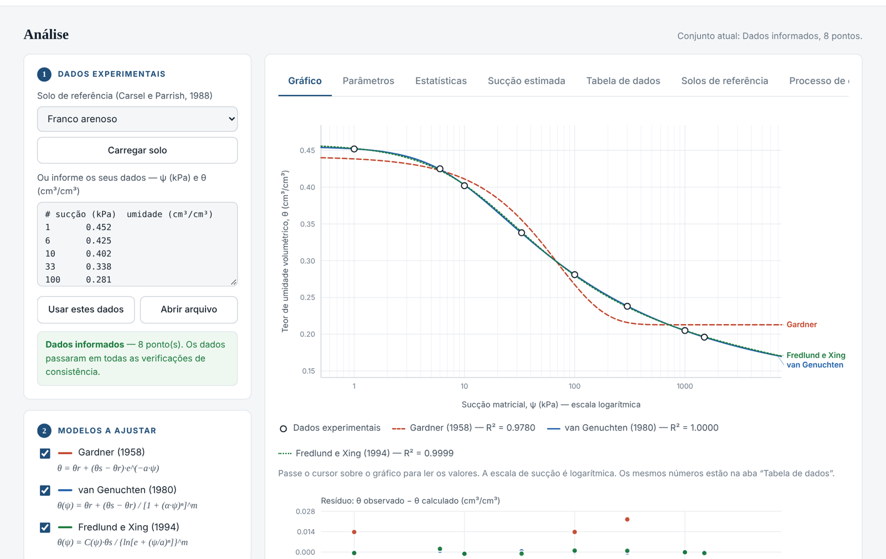
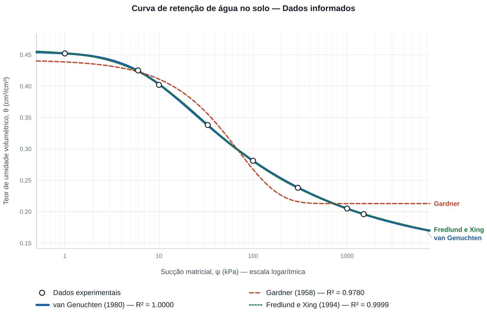
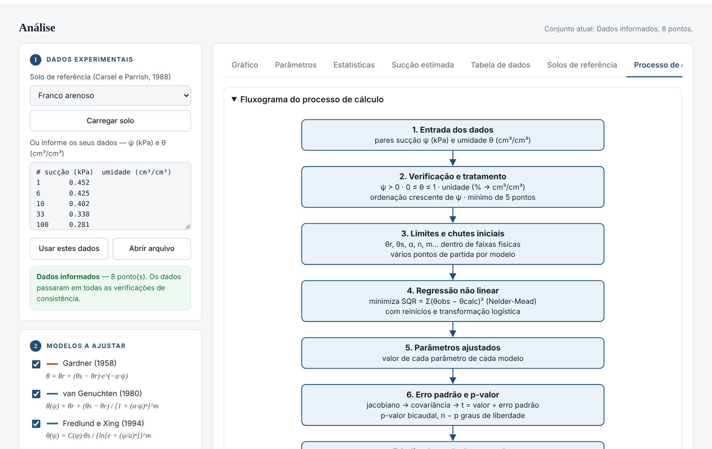

<p align="center"></p>

# CRAS — Curva de Retenção de Água no Solo

Ferramenta computacional para **ajuste da curva de retenção de água no solo**, **avaliação estatística** dos modelos e **estimativa da sucção matricial**.

Ajusta os modelos de **Gardner (1958)**, **van Genuchten (1980)** e **Fredlund e Xing (1994)** a pares de sucção matricial (kPa) e teor de umidade volumétrico (cm³/cm³), compara o desempenho por R², R² ajustado, RMSE, MAE, AICc e p-valor, e estima a sucção correspondente a um teor de umidade informado.

> 🌐 **Use agora no navegador:** https://marianerochalima.github.io/cras/
> 💻 **Baixe para Windows:** [página de Releases](https://github.com/marianerochalima/cras/releases)
> 📘 **Manual do usuário:** [docs/Manual_do_Usuario_CRAS.pdf](docs/Manual_do_Usuario_CRAS.pdf)



## Funcionalidades

- Entrada de dados digitados, colados ou abertos de arquivo `.csv`, `.txt` ou `.xlsx`
- Verificação automática dos dados: conversão de % para cm³/cm³, exclusão de pontos inválidos, ordenação por sucção e exigência mínima de 5 pontos
- 12 solos de referência de Carsel e Parrish (1988), por classe textural do USDA
- Ajuste por mínimos quadrados não lineares, com limites físicos e várias estimativas iniciais
- Erro padrão, estatística t e **p-valor** de cada parâmetro
- Indicadores R², R² ajustado, RMSE, MAE e AICc, com **qualificação dos modelos** pela média das posições
- Pressão de entrada de ar, umidade na capacidade de campo (10 kPa) e no ponto de murcha permanente (1500 kPa) e água disponível
- **Estimativa da sucção matricial** a partir de um teor de umidade
- **Processo de cálculo passo a passo**, com equações e substituições usando os dados do usuário
- Exportação dos resultados em CSV e do gráfico em PNG ou SVG



## Como usar

### No navegador (sem instalar nada)
Acesse https://marianerochalima.github.io/cras/ ou baixe o arquivo `index.html` e abra-o no Chrome, Edge ou Firefox. Os cálculos são feitos no próprio computador, e nenhum dado é enviado para a internet.

### No Windows (programa desktop)
1. Baixe o `CRAS.exe` na [página de Releases](https://github.com/marianerochalima/cras/releases) e dê dois cliques.
2. Na primeira vez, o Windows pode mostrar o aviso *"O Windows protegeu o computador"*, porque o programa não tem assinatura digital paga. Clique em **Mais informações → Executar assim mesmo**.

### Pelo código-fonte em Python
Requer Python 3.10 ou superior.
```bash
cd desktop
pip install -r requirements.txt
python CRAS_desktop.py
```
No Windows, basta dar dois cliques em `desktop/Executar_CRAS.bat`. Para gerar o `.exe`, use `desktop/Gerar_executavel.bat` (PyInstaller).

## Passo a passo

1. **Dados experimentais** — carregue um solo de referência, digite ou cole os pares sucção–umidade, ou abra um arquivo. A ferramenta informa quantos pontos são válidos e as correções aplicadas.
2. **Modelos a ajustar** — marque os modelos de interesse (Gardner, van Genuchten e/ou Fredlund e Xing).
3. **Ajustar modelos** — os resultados preenchem as abas abaixo e podem ser exportados.

| Aba | O que mostra |
|---|---|
| Gráfico | Pontos experimentais, curvas ajustadas (escala semilogarítmica) e resíduos de cada modelo |
| Parâmetros | Valor, erro padrão, estatística t e p-valor de cada parâmetro |
| Estatísticas | R², R² ajustado, RMSE, MAE, AICc, qualificação dos modelos e índices derivados (entrada de ar, capacidade de campo, ponto de murcha, água disponível) |
| Sucção estimada | Sucção correspondente a um teor de umidade informado, para cada modelo |
| Tabela de dados | Valores observados, calculados e resíduos, ponto a ponto |
| Solos de referência | Parâmetros de Carsel e Parrish (1988) por classe textural |
| Processo de cálculo | Memória de cálculo em 10 passos, com equações e substituições numéricas |

**Dicas de interpretação:** confira primeiro os resíduos (padrão sistemático indica erro de forma do modelo, mesmo com R² alto); use o AICc para escolher entre modelos de qualidade parecida; desconfie de parâmetros com p > 0,05; e use pelo menos 8 pontos para ajustar os três modelos com folga. Detalhes no [manual do usuário](docs/Manual_do_Usuario_CRAS.pdf).

## Formato dos dados

Duas colunas, separadas por ponto e vírgula, tabulação, vírgula ou espaço: **sucção (kPa)** e **teor de umidade (cm³/cm³ ou %)**. O cabeçalho é opcional, e linhas iniciadas por `#` são ignoradas. Veja o exemplo em [`exemplos/exemplo_dados.csv`](exemplos/exemplo_dados.csv).

```
# sucção (kPa);umidade (cm³/cm³)
1;0.452
10;0.402
100;0.281
1500;0.196
```

## Métodos

| Etapa | Método |
|---|---|
| Ajuste | Mínimos quadrados não lineares: `scipy.optimize.curve_fit`, algoritmo *Trust Region Reflective* (versão desktop), e método simplex de Nelder e Mead (versão web), com limites físicos e 3 ou 4 estimativas iniciais |
| Erro padrão | Cov = s²·(JᵀJ)⁻¹, com s² = SQR/(N − p) |
| p-valor | Teste t bicaudal, H₀: parâmetro = 0, com N − p graus de liberdade |
| Indicadores | R², R²aj, RMSE, MAE e AICc (Akaike, 1974; Hurvich e Tsai, 1989) |
| Qualificação | Média das posições de cada modelo em R²aj, RMSE, MAE e AICc |
| Sucção estimada | Inversa analítica (Gardner e van Genuchten) e método de Brent ou bisseção (Fredlund e Xing) |



## Estrutura do repositório

```
index.html            versão web (abre direto no navegador e no GitHub Pages)
docs/                 manual do usuário (PDF)
desktop/              versão desktop em Python (Tkinter, NumPy, SciPy, Matplotlib, pandas, openpyxl)
exemplos/             arquivo de dados de exemplo
imagens/              figuras deste README
```

## Como citar

> LIMA, M. R. **CRAS: aplicativo computacional para estimativa da sucção matricial e avaliação estatística de modelos de ajuste da curva de retenção de água no solo**. Versão 1.0. Patos: UNIFIP, 2026. Disponível em: https://github.com/marianerochalima/cras.

## Autoria

Desenvolvido por **Mariane Rocha Lima** como Trabalho de Conclusão de Curso em Engenharia Civil no UNIFIP — Centro Universitário de Patos (PB).
Orientação: Prof. Me. Vinicius da Silva Vieira. Coorientação: Prof. Dr. Pabllo da Silva Araújo.

## Referências

- AKAIKE, H. A new look at the statistical model identification. *IEEE Transactions on Automatic Control*, v. 19, n. 6, p. 716–723, 1974.
- CARSEL, R. F.; PARRISH, R. S. Developing joint probability distributions of soil water retention characteristics. *Water Resources Research*, v. 24, n. 5, p. 755–769, 1988.
- FREDLUND, D. G.; XING, A. Equations for the soil-water characteristic curve. *Canadian Geotechnical Journal*, v. 31, n. 4, p. 521–532, 1994.
- GARDNER, W. R. Some steady-state solutions of the unsaturated moisture flow equation with application to evaporation from a water table. *Soil Science*, v. 85, n. 4, p. 228–232, 1958.
- HURVICH, C. M.; TSAI, C.-L. Regression and time series model selection in small samples. *Biometrika*, v. 76, n. 2, p. 297–307, 1989.
- NELDER, J. A.; MEAD, R. A simplex method for function minimization. *The Computer Journal*, v. 7, n. 4, p. 308–313, 1965.
- VAN GENUCHTEN, M. Th. A closed-form equation for predicting the hydraulic conductivity of unsaturated soils. *Soil Science Society of America Journal*, v. 44, n. 5, p. 892–898, 1980.

## Licença

Distribuído sob a licença MIT. Veja o arquivo [LICENSE](LICENSE).
